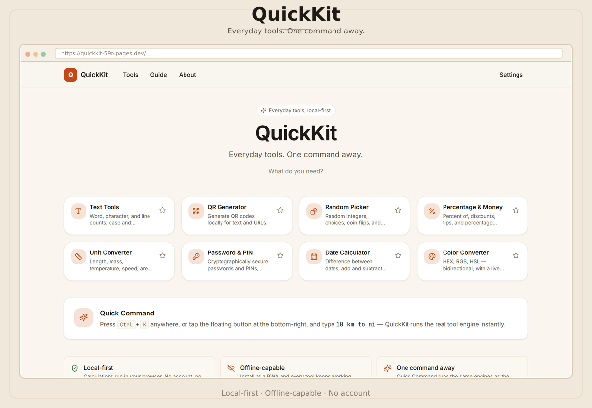

# QuickKit



A local-first, offline-capable browser utility suite for everyday tools.

**Production:** https://quickkit-59o.pages.dev/

## Features

- **Local-first** — every calculation runs in your browser
- **Privacy-conscious** — no account, no backend, no database, no analytics
- **Offline-capable** — installable as a PWA with a service worker
- **Static** — Next.js static export, no server runtime
- **Quick Command** — global command bar (Ctrl/Cmd+K) that runs the same engines as the tools

## Tools

1. **Unit Converter** — length, mass, temperature, speed, area, digital storage
2. **Percentage & Money** — percent of, discounts, tips, percentage change
3. **QR Generator** — generate QR codes locally for text and URLs
4. **Password & PIN** — cryptographically secure passwords and PINs, never saved
5. **Date Calculator** — difference between dates, add/subtract durations
6. **Text Tools** — word/character/line counts, case transforms, whitespace fixes
7. **Random Picker** — random integers, choices, coin flips, dice
8. **Color Converter** — HEX, RGB, HSL — bidirectional, with live preview

## Tech Stack

- Next.js 16 (App Router, `output: "export"`)
- React 19, TypeScript 5 (strict)
- Tailwind CSS 4
- Zustand (state management)
- PWA service worker (offline)

## Local Development

```bash
bun install
bun run dev
```

Open http://localhost:3000

## Production Build

```bash
bun run build
```

Output is generated in `out/`. No server runtime is required — everything is static HTML/CSS/JS.

## Deploy to Cloudflare Pages

QuickKit is deployed as a **static Next.js export** to **Cloudflare Pages**.

```
Next.js → next build → out/ → Cloudflare Pages
```

This project targets **Cloudflare Pages**, NOT Cloudflare Workers.

### One-time setup

If the Pages project doesn't exist yet:

```bash
npx wrangler pages project create quickkit --production-branch main
```

### Local Pages validation

Test the built artifact through Wrangler's Pages emulator:

```bash
bun run pages:dev
# equivalent: wrangler pages dev out
```

### Production deployment

```bash
bun run pages:deploy
# equivalent: bun run build && wrangler pages deploy out --project-name quickkit
```

Or deploy an already-built `out/`:

```bash
bun run pages:deploy:only
# equivalent: wrangler pages deploy out --project-name quickkit
```

### DO NOT use `wrangler deploy`

`wrangler deploy` deploys a **Worker**, not a Pages project. Always use `wrangler pages deploy`.

### Wrangler configuration

The repository uses `wrangler.jsonc` with Pages configuration:

```jsonc
{
  "name": "quickkit",
  "pages_build_output_dir": "./out",
  "compatibility_date": "2026-10-15"
}
```

This uses `pages_build_output_dir` (Pages) — NOT `assets.directory` (Workers). No `main`, no Worker entrypoint, no Pages Functions.

### Cloudflare Dashboard (Git deployment alternative)

| Setting | Value |
|---|---|
| Platform | Cloudflare Pages |
| Framework preset | Next.js (Static HTML Export) |
| Production branch | `main` |
| Build command | `bun run build` |
| Build output directory | `out` |
| Environment variable | `NEXT_PUBLIC_SITE_URL=https://quickkit-59o.pages.dev/` |

## Useful Commands

| Command | Description |
|---|---|
| `bun run dev` | Start dev server (port 3000) |
| `bun run build` | Production build → `out/` |
| `bun run lint` | ESLint |
| `bun run typecheck` | TypeScript type check |
| `bun test` | Run unit tests |
| `bun run pages:dev` | Test built output via Wrangler Pages |
| `bun run pages:deploy` | Build + deploy to Cloudflare Pages |

## Privacy

- No account, no backend, no database, no analytics
- All calculations run locally in the browser
- Sensitive data (passwords, PINs, QR payloads, raw text) is never persisted
- Only theme, favorites, and recent-tool IDs are stored in `localStorage`
- No operation history feature
- Installable as a PWA for offline use

## License

MIT — see [LICENSE](./LICENSE).

## Author

**Asaad** — student developer.
